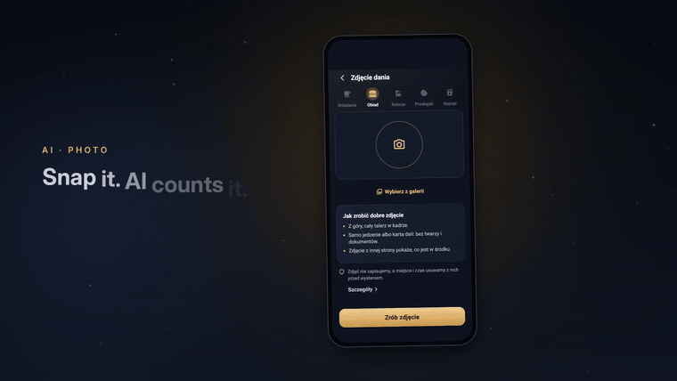
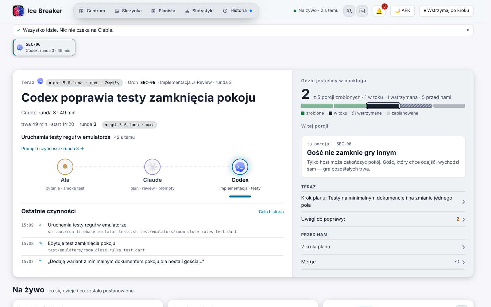
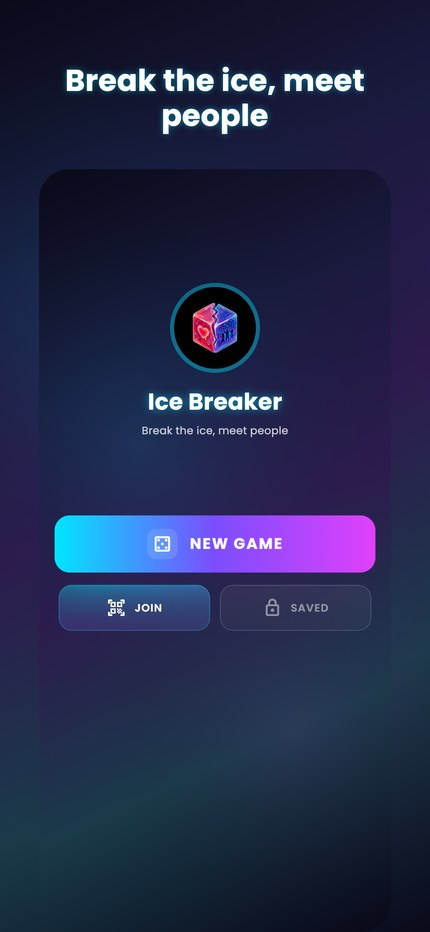
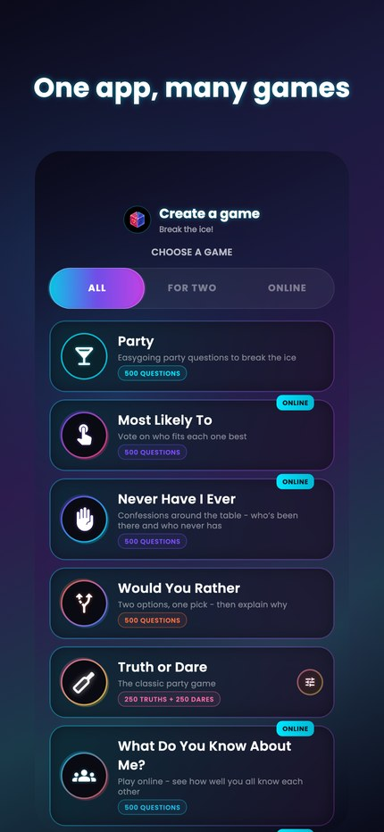
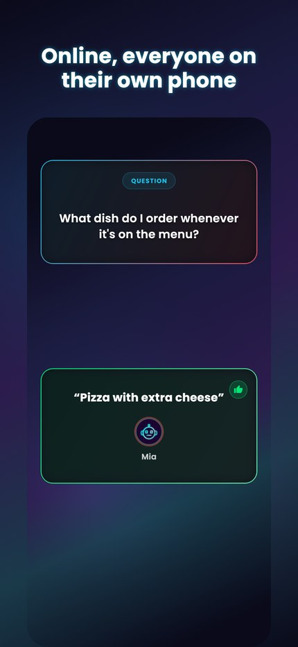

# Wojciech Lach · Project showcase

I am an analyst and AI automation consultant. Outside client work I build products end to end:
I own the product decisions and the delivery process, and AI agents write the code under that
process. This repository shows three of these projects with real screenshots, a video and short
architecture notes.

The source code of all three projects is private. This repository contains descriptions, images
and a video only, so nothing here can be built or copied.

| Project | What it is | Status |
|---|---|---|
| [**Crumbly**](crumbly/README.md) | iOS nutrition diary with AI meal logging (Claude API) | In daily use, 10 testers on TestFlight |
| [**Multi-agent delivery platform**](agent-platform/README.md) | System that plans, implements, reviews, tests and merges software changes with AI agents | Used to build Ice Breaker since Sep 2026 |
| [**Ice Breaker**](ice-breaker/README.md) | Party game for iOS with local and real-time online modes | Closed beta on TestFlight |

---

## Crumbly: nutrition diary with AI

Log a meal from a photo or a sentence, scan a barcode, check a label, see the weight trend.
Built in three weeks with 770+ pull requests and about 7,900 automated tests.
[Read more and watch the video →](crumbly/README.md)

## Multi-agent delivery platform

An orchestrator agent runs a backlog of small work packages. Executor agents implement each
one in an isolated Git worktree; a reviewer agent checks it; automated gates and a tiered smoke
test decide when it can merge. I take part only where a human decision is needed.
[Read more →](agent-platform/README.md)

## Ice Breaker: party game

  
  
  

Question, voting and quiz games for groups, played on one phone or online with everyone on
their own device. [Read more →](ice-breaker/README.md)

---

Contact: [linkedin.com/in/wojciech-lach-tak-to-on](https://www.linkedin.com/in/wojciech-lach-tak-to-on/)

© Wojciech Lach. Screenshots and video are shared for portfolio viewing only.
