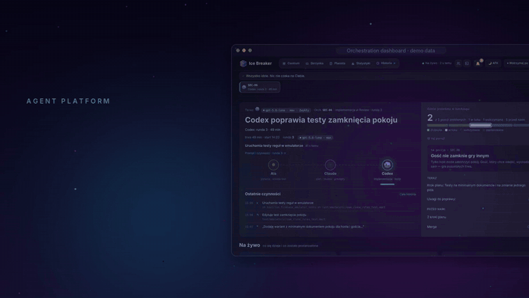
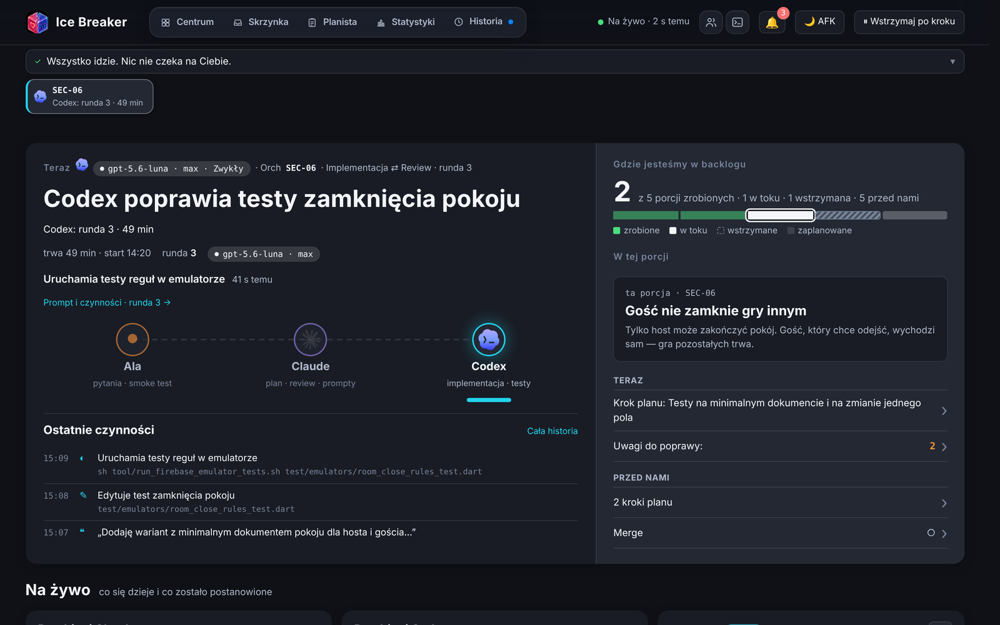
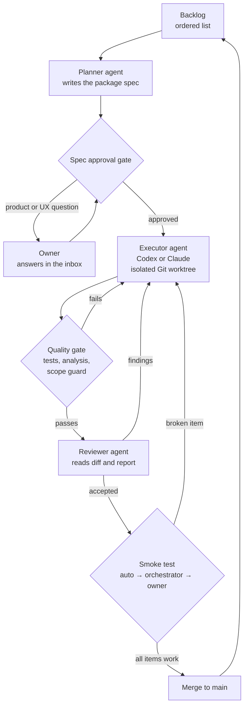
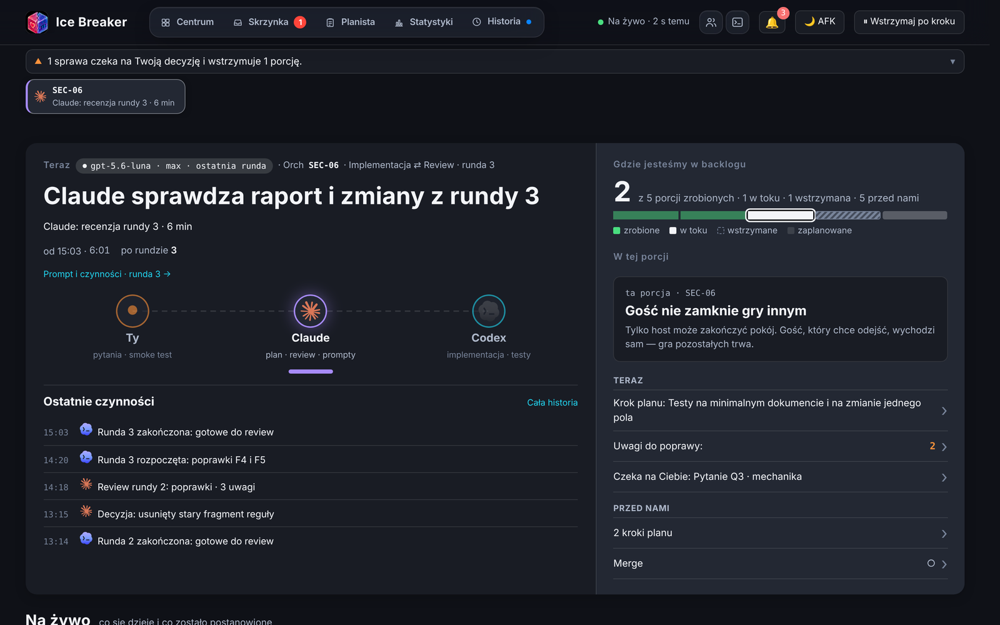
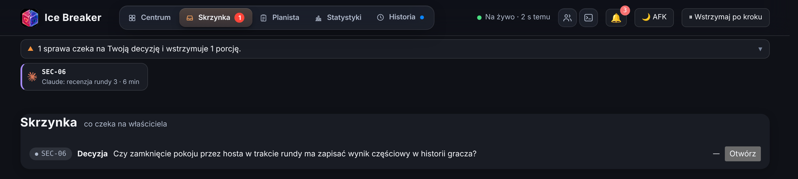
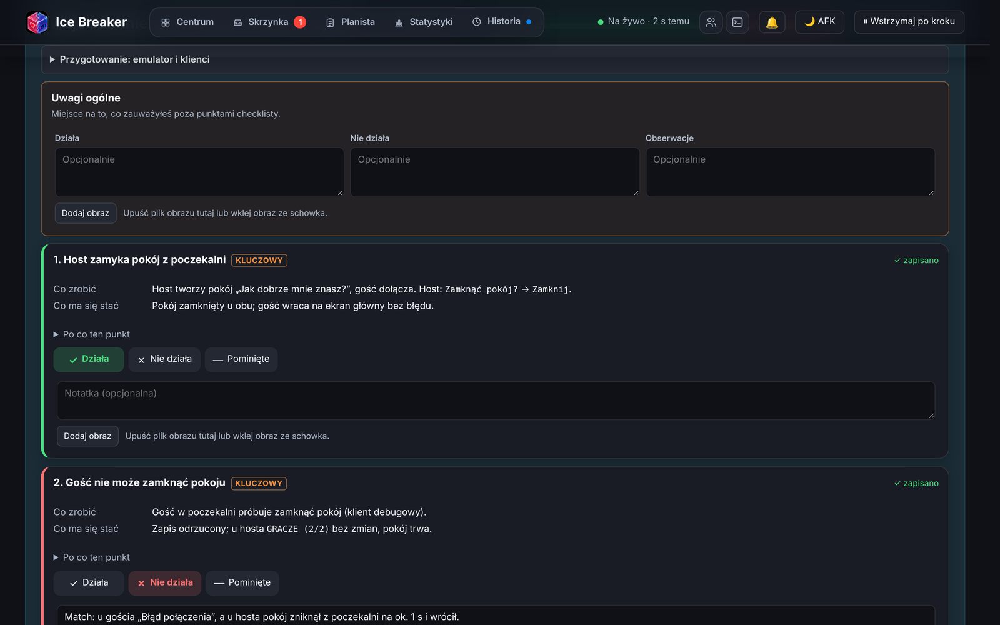
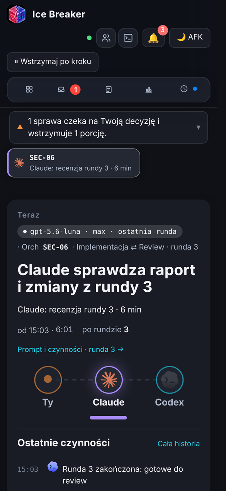
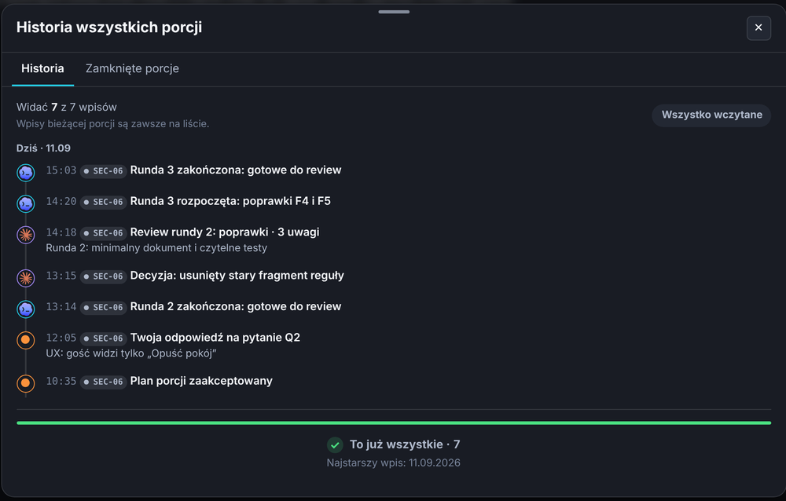

# Multi-agent software delivery platform

A system I designed and built to develop Ice Breaker with AI agents. It turns a written backlog
into merged, tested changes. Agents plan, implement, review, test and merge; I define the
workflow and decide only what needs a human: product mechanics, UX and design, the final smoke
test on a device and anything irreversible.

Built with Python and JavaScript on top of Claude Code and Codex CLI. In use since September 2026.

The full walkthrough is in the [Ice Breaker video](../ice-breaker/media/ice-breaker-showcase.mp4)
(second half).

*Dashboard with demo data: the current work package, who has the ball (owner, Claude, Codex),
latest actions and progress through the backlog.*

## How a work package flows

- **One package, one layer.** Each package has an approved scope. The executor commits small
  increments in its own worktree and never pushes, merges or rewrites history.
- **Review in rounds.** A reviewer agent reads the diff, the run report and targeted test
  evidence. Findings go back to the same executor session as a fix round.
- **Tiered smoke test.** Automated checks first, then the orchestrator's own checks, and the
  owner only for what needs a real device. When every item works, the orchestrator merges
  without waiting for me.
- **Owner as a gate, not a relay.** I answer questions and do my part of the smoke test. The
  orchestrator picks the next backlog item itself and never routes prompts through me.

*A reviewer agent checks round 3 while one product question waits for the owner.*

*The inbox holds only what needs a human decision.*

*My part of the smoke test: each item is marked as working, broken or skipped, with notes and
screenshots. A clean checklist lets the orchestrator merge.*

## Running for hours without supervision

- **Context handoff.** A session is a consumable: at 85% context usage the agent writes a
  handoff and a fresh session continues from it.
- **Limits and cost.** The dashboard tracks usage limits of every agent account. Model and
  effort are chosen per task using cost estimates from previous runs; a metered fallback
  provider has a daily budget cap.
- **AFK mode.** When I am away, work continues on the ordered backlog; questions are parked
  and I get a phone notification only when a decision is really needed.
- **Mobile dashboard.** The same live view works on a phone.

  
  

## Scale so far

Numbers from the platform's own state file, 15 September – 4 November 2026:

| | |
|---|---|
| Work packages closed | 1,000+ |
| Executor runs | 700+ |
| Review rounds recorded | ~1,400 |
| Decisions logged | ~1,700 |
| Python test files for the platform itself | 280+ |

Screenshots come from the dashboard's built-in demo mode, so names, models and tasks in them
are sample data.
