

# Crumbly: nutrition diary with AI

An iOS app for counting calories and macros without the usual friction. I lead it as product
owner and deliver it with AI agents. Started on 3 November 2026, in production since
6 November, now in daily use with 10 testers on TestFlight.

**Video (1:41, no sound):** [crumbly-showcase.mp4](media/crumbly-showcase.mp4)

> Tip: to get an inline player on GitHub, open this file in the web editor and drag the mp4
> into it. GitHub then hosts the video and shows a player.

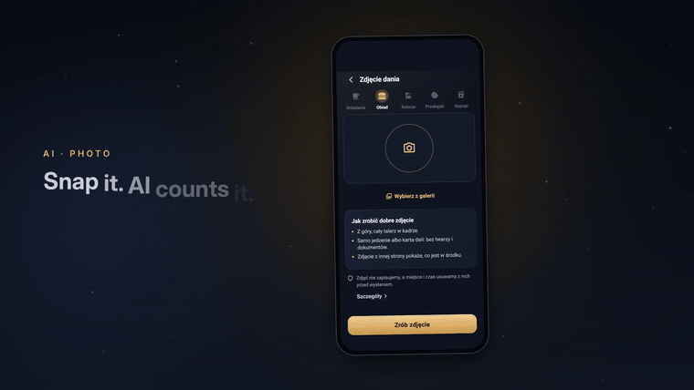

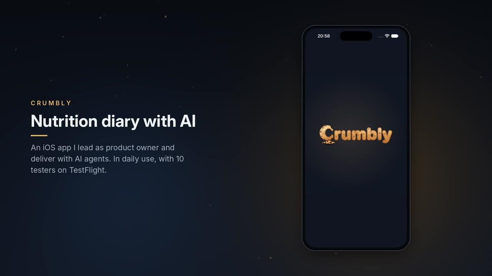

## What makes it different

### AI meal logging
Up to three photos and a short note. The model recognises dishes and ingredients and returns
a meal you can edit item by item. Nothing is saved until you confirm. You can also describe a
meal in words ("burger from the menu") or ask the assistant about your day.

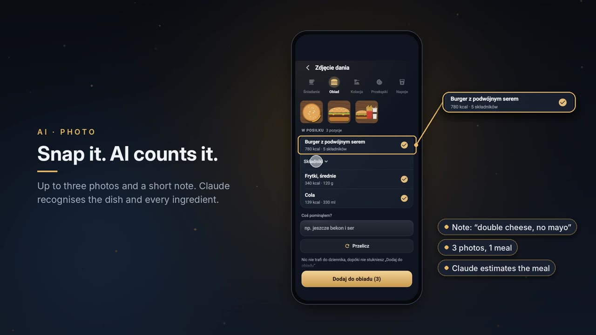
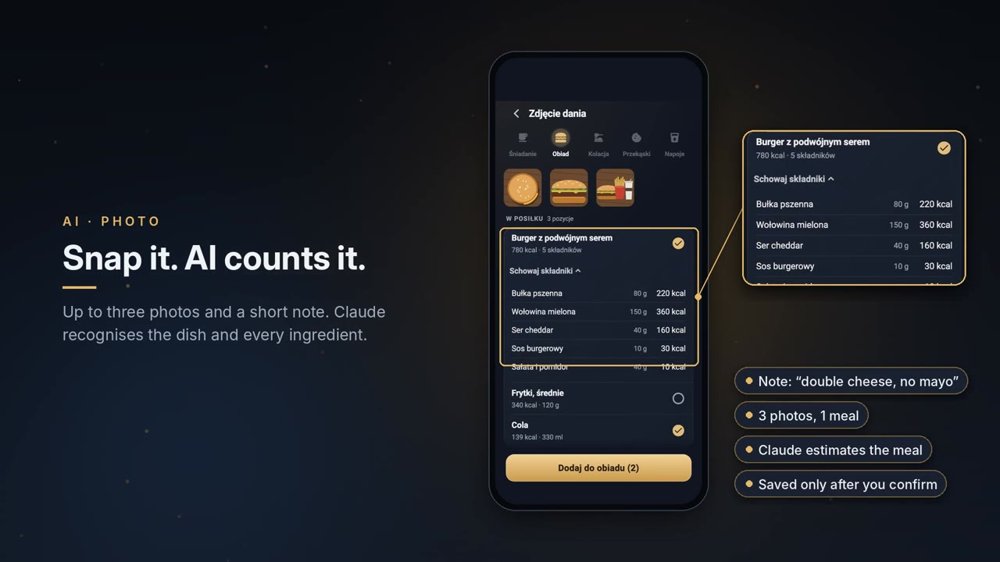
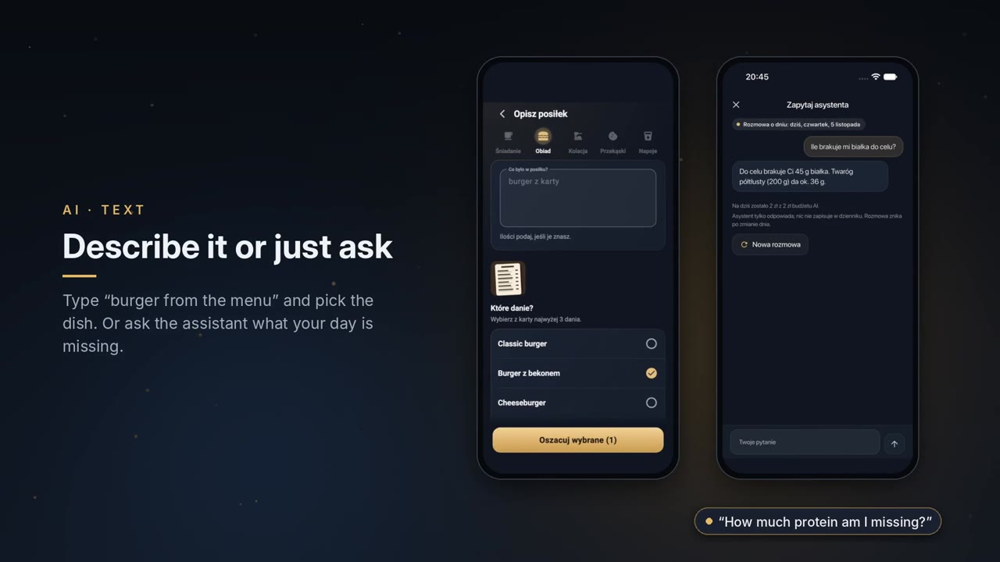

### Checks instead of blind trust
Scan a barcode to get the product from a shared database. If the numbers look off, AI reads
the nutrition table from a photo of the label and compares it with the database field by
field. Estimates go through plausibility checks before they reach the diary.

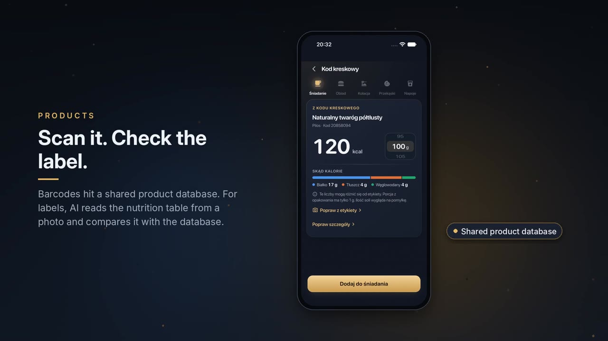
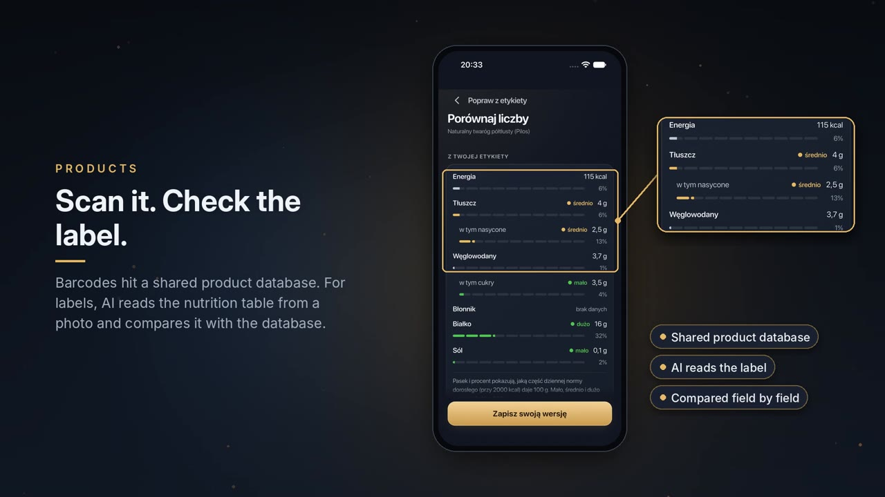

### A plan that adapts
A short onboarding sets the goal, the pace and a few safety questions, then a daily calorie and
macro target. The target is recalibrated from the weight trend and Apple Health activity.

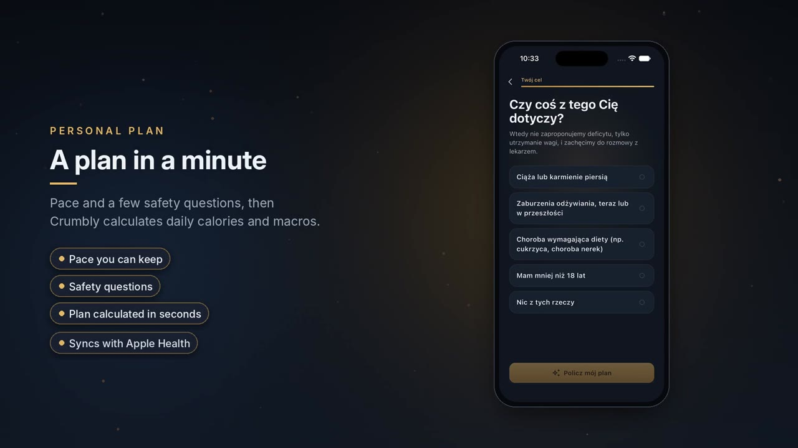
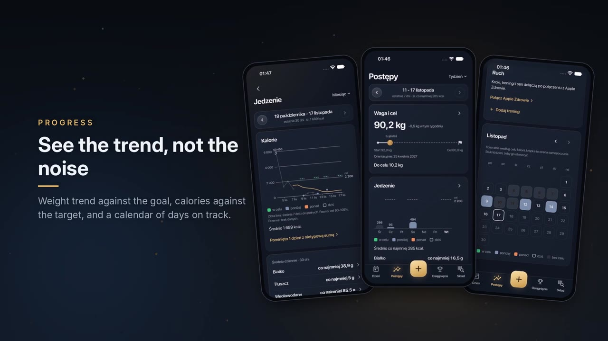

### Everyday logging
Portions of home-cooked dishes sliced on a board or plate, pieces of fruit or eggs, "same as
yesterday", water, workouts from Apple Health, weekly challenges, sharing a meal or a whole
day by link or QR code, and home screen widgets.

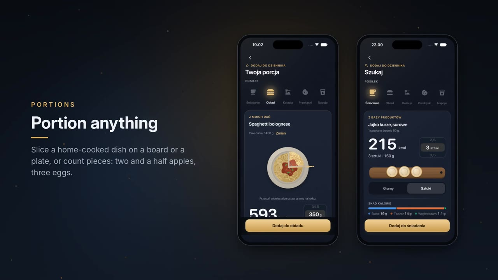
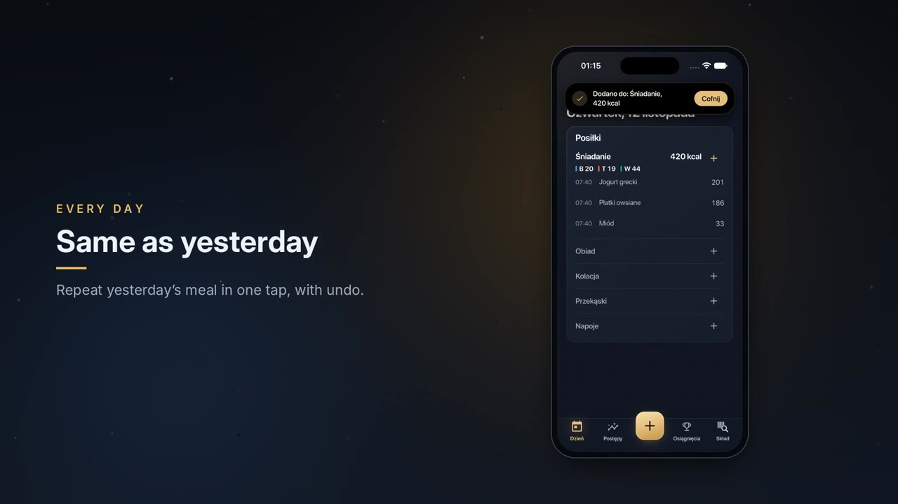
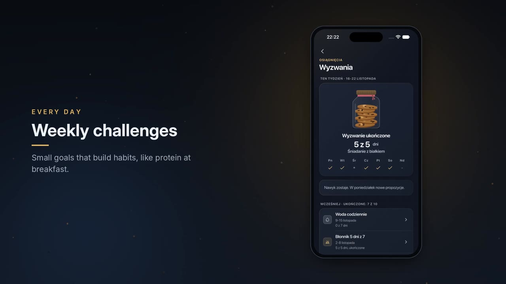
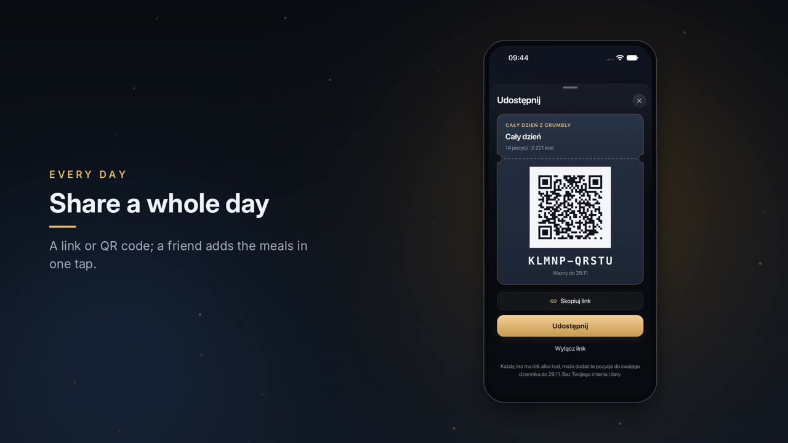

### Crumbly Plus
AI features (photo and text logging, restaurant dishes looked up on the web, meal ideas) are
part of a subscription sold through Apple in-app purchase.

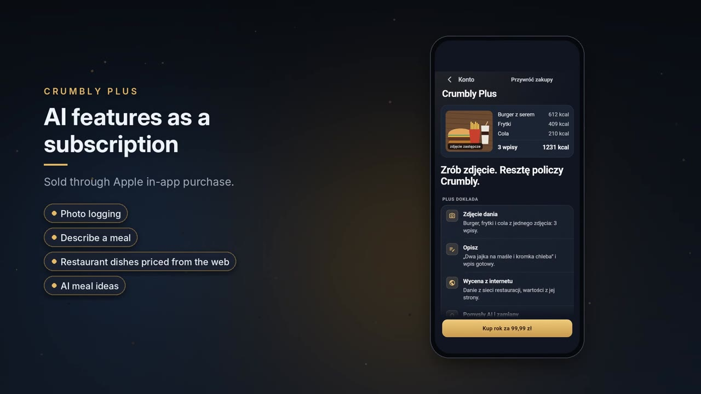

## How it is built

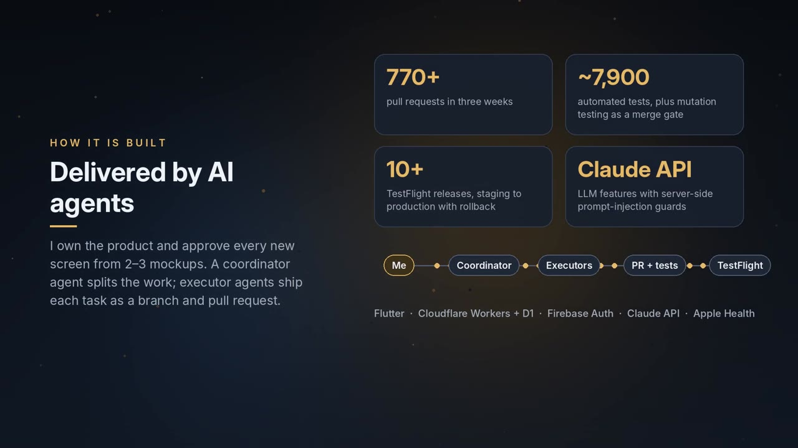

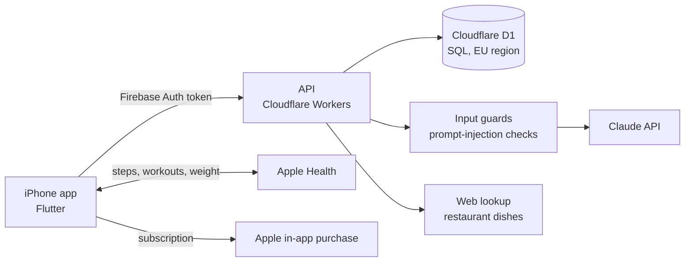

| | |
|---|---|
| Delivery | 770+ pull requests and ~4,400 commits in three weeks |
| Quality gate | ~7,900 automated tests (API and app) plus mutation testing before merge |
| Releases | Separate staging and production, rollback points, 10+ TestFlight builds |
| AI safety | Server-side guards and regular test runs against prompt injection |
| Privacy | Meal photos are not stored; location and time metadata is removed before upload |

### My role and the delivery process

I own the product: priorities, scope and every new screen, which I choose from 2–3 mockup
variants. A coordinator agent splits the work into tasks; executor agents in cloud sessions
deliver each task as a separate branch and pull request, and the tests decide whether it can
merge.

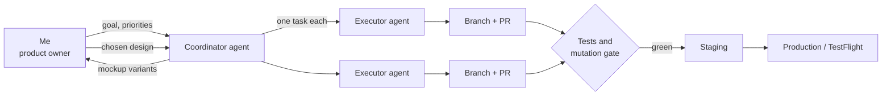

Stack: Flutter · Cloudflare Workers + D1 · Firebase Auth · Claude API · Apple Health · Apple IAP

All data in the screenshots is test data.
