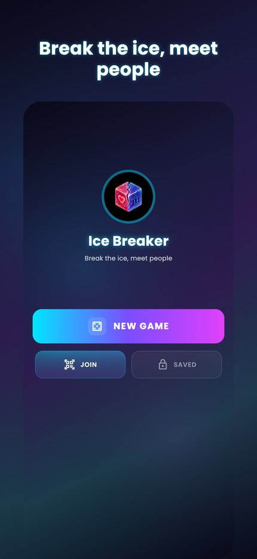
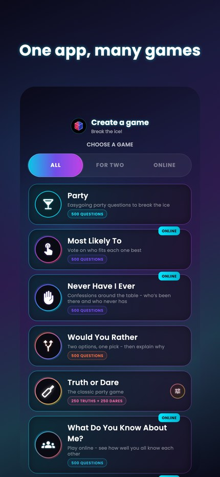
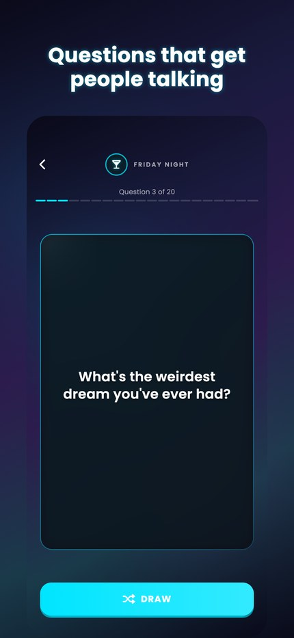
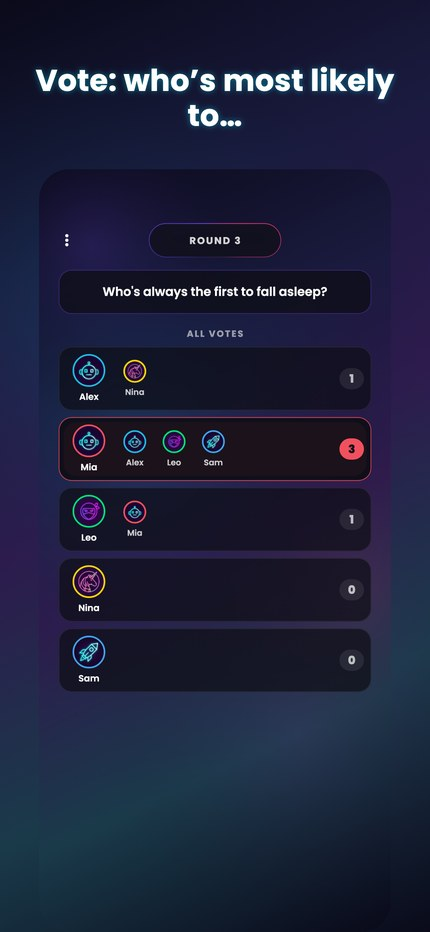
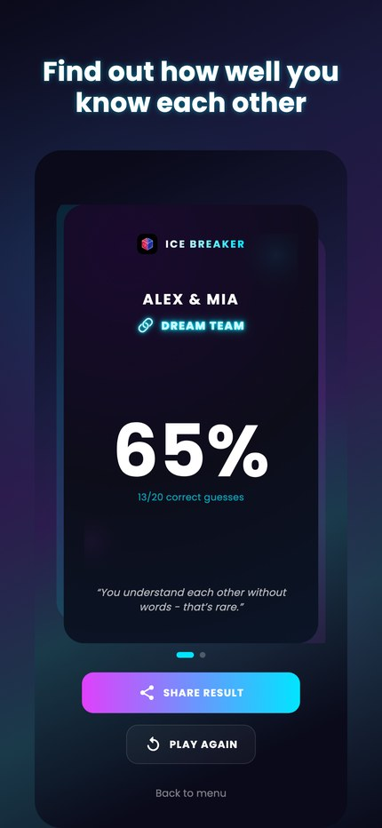
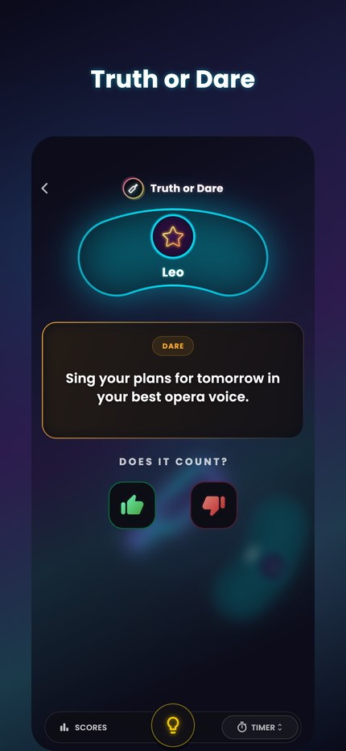
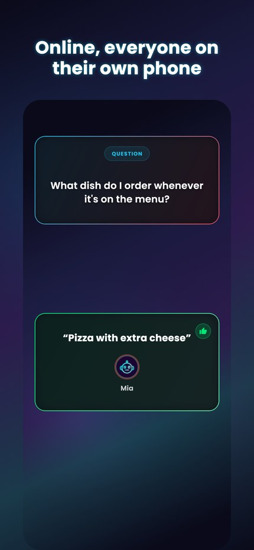
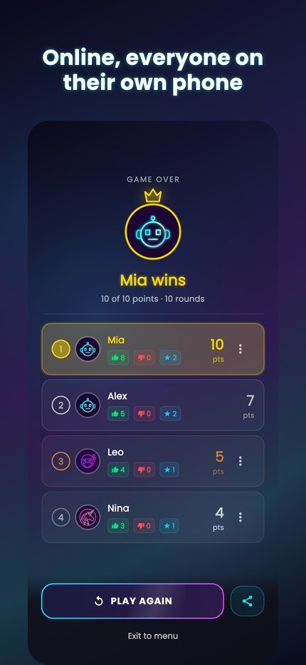
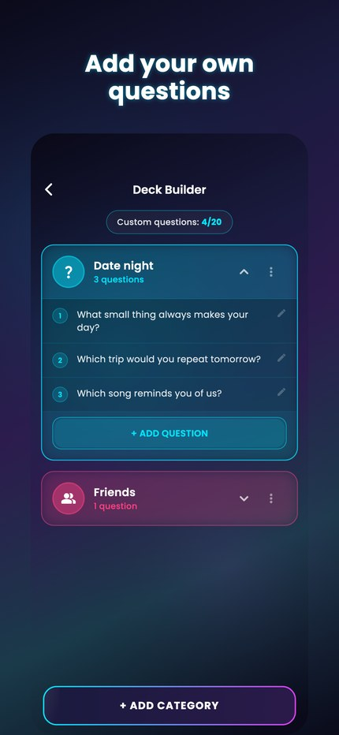
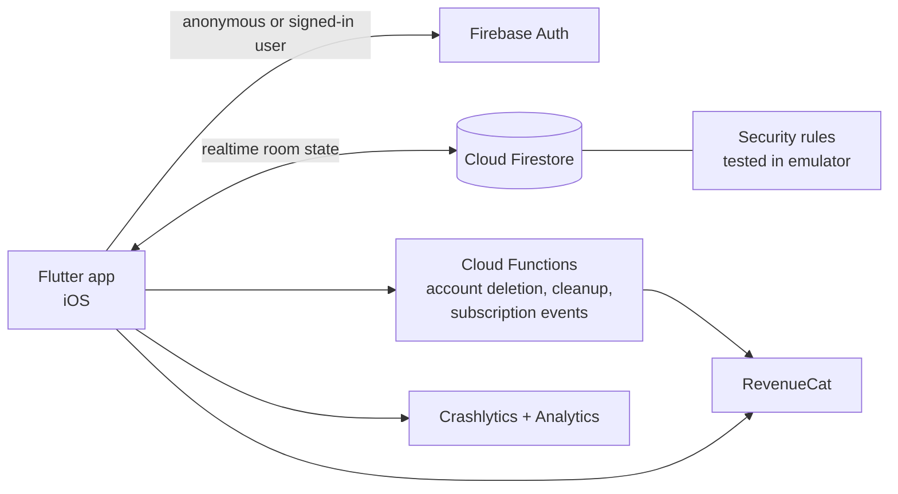

# Ice Breaker: party game

A mobile game that gets a group talking: question cards, voting, quizzes about each other and
Truth or Dare. Play on one phone passed around the table, or online with everyone on their own
device. Built with Flutter and Firebase, developed since December 2025 and, since September 2026,
through my [multi-agent delivery platform](../agent-platform/README.md). Now in closed beta on
TestFlight.

**Video (1:19, no sound):** [ice-breaker-showcase.mp4](media/ice-breaker-showcase.mp4). The first half shows
the game, the second half shows how the platform builds it: executor, reviewer, my product
questions, the smoke test and the guards.

  
  
  

  
  
  

  
  
  

## Features

- **Game modes:** Party questions, Most Likely To, Never Have I Ever, Would You Rather, Truth or
  Dare, a quiz on how well two people know each other, and What Do You Know About Me?
- **Online play:** the host creates a room with a 6-character code or QR code; answers, votes
  and drawings sync in real time.
- **Own content:** a deck builder for custom questions and categories.
- **Subscriptions:** premium decks through RevenueCat and App Store in-app purchase.
- **Languages:** Polish, English, German and French.

## Architecture

| | |
|---|---|
| Commits | ~5,900 since December 2025 |
| App test files | 560+ (unit, widget and Firestore-rules tests) |
| Quality | Multiplayer smoke tests on two iOS simulators against local Firebase emulators |

Screenshots are App Store marketing images with sample players.
